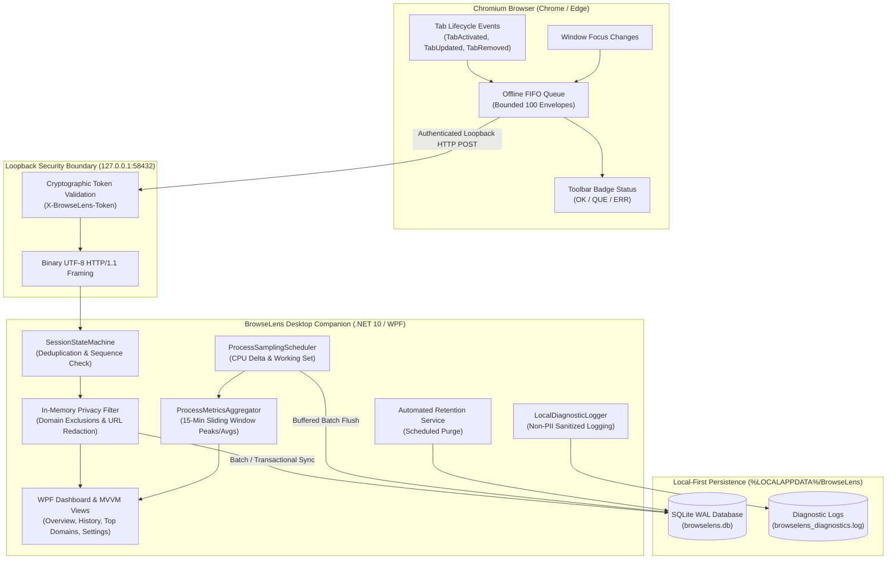

<div align="center">

# BrowseLens

**See Your Browsing Clearly.**

[](LICENSE)
[](https://www.microsoft.com/windows)
[](https://dotnet.microsoft.com/)
[-success.svg)](08-Testing/TEST-PLAN.md)
[](02-Technical/BROWSELENS-TRD.md)

*A privacy-first, local-only Windows desktop companion and Chromium extension for tracking active browsing time and browser process resource consumption.*

---

</div>

## Overview

**BrowseLens** is a transparent browser observability tool engineered for Windows. It pairs a lightweight Chromium extension (Chrome and Edge) with a native Windows desktop companion application to measure active foreground website browsing duration and browser process resource utilization (CPU & RAM) — stored entirely on your computer in a local SQLite database, with **zero cloud upload, zero telemetry, and zero tracking of page content**.

### Why BrowseLens?
- **Zero Background Time Inflation:** Unlike naive browser timers that accumulate hours for tabs left running in the background, BrowseLens only measures active foreground time when a tab is currently selected in a focused browser window.
- **Accurate Resource Visibility:** Displays real process-level CPU utilization (%) and Working Set memory consumption (MB) across browser process trees, with 15-minute rolling average and peak analysis.
- **Strict Privacy Guarantees:** Page content, form inputs, passwords, keystrokes, clipboard data, and screenshots are never observed or captured. Incognito browsing is rejected by default.
- **100% Local-First Storage:** Data is stored exclusively in your local `%LOCALAPPDATA%/BrowseLens/` directory in a high-performance SQLite database operating in WAL mode.

---

## Architecture



---

## Key Features

### 1. Deterministic Foreground Time Accounting
- **Clean Transitions:** Switching tabs instantly closes the prior interval and begins the new one with microsecond accuracy. Zero overlapping sessions and zero double-counting.
- **Window Focus Integration:** Minimizing the browser or switching away to another desktop application immediately stops active time accumulation.
- **Multi-Tab Resilience:** Verified against complex realistic user browsing patterns (rapid tab switching, background tab closure, in-page navigation, and new tab addition).
- **Crash Recovery:** Abrupt desktop app restarts or shutdowns cleanly close orphaned sessions without inflating unobserved downtime.

### 2. Browser Process Resource Telemetry
- **Hardware-Normalized CPU:** CPU utilization calculated from precise Windows process kernel/user time deltas divided by system time deltas and logical core counts, clamped to 100%.
- **Working Set RAM:** Tracks private and shared physical memory across all browser renderer, GPU, utility, and browser-broker processes.
- **15-Minute Rolling Aggregates:** Calculates rolling average CPU, peak CPU, and peak Working Set memory over a 15-minute sliding window.

### 3. Privacy & Security Controls
- **URL Query & Fragment Redaction:** Query parameters (`?token=secret`) and URL hash fragments (`#access_token`) are automatically stripped before storage.
- **Domain Exclusion Filter:** Exclude sensitive domains (e.g., `*.bank.com`, `internal.corp`) using wildcard pattern rules. Excluded domains are dropped in-memory and **never touch the database**.
- **Automated Retention Purge:** Background service purges browsing sessions and performance samples older than the user-configured retention threshold (default 30 days).
- **On-Demand History Deletion:** Delete individual sessions, custom date ranges, or execute an immediate full database wipe.

### 4. Native Windows Desktop Dashboard
- **Overview Screen:** Active tab live hero card, today's total browsing time, live browser resource gauges for Chrome & Edge, and quick website overview.
- **Browsing History Screen:** Searchable history table with real-time text filtering (domain, title, URL) and custom date ranges (Today, 7 Days, 30 Days, All History).
- **Top Domains Screen:** Ranked website breakdown with duration formatting, visit counters, and relative percentage-of-total time metrics.
- **Settings Screen:** Prominent tracking pause toggle, token display/configuration, URL redaction switch, wildcard exclusion list manager, and retention policy settings.

---

## Repository Structure

```text
BrowseLens/
├── BrowseLens.sln                   # Visual Studio / .NET 10 Solution File
├── README.md                        # Project documentation & quick start
├── LICENSE                          # MIT License
├── CONTRIBUTING.md                  # Contribution guidelines & principles
├── .gitignore                       # Standard .NET / VS / Node ignore rules
│
├── 01-Requirements/                 # Business (BRD) and Functional (FRD) specs
├── 02-Technical/                    # Technical architecture & design decisions
├── 03-Delivery/                     # Roadmap, traceability, release notes
├── 04-Agent-Instructions/           # Engineering agent workflow protocols
├── 05-Architecture/                 # In-depth architectural designs
├── 06-Database/                     # SQLite schema & migration specifications
├── 07-API/                          # Loopback HTTP IPC contract & schemas
├── 08-Testing/                      # Complete test matrix & verification plans
├── 09-Operations/                   # Build, run, deploy & feasibility reports
│
├── src/
│   ├── BrowseLens.Core/             # Entities, StateMachine, TimeAccounting, Privacy
│   ├── BrowseLens.Infrastructure/   # SQLite Migrator & Repos, IPC Server, Process Sampler
│   ├── BrowseLens.Desktop/          # WPF Desktop UI, MVVM ViewModels, Commands
│   └── BrowseLens.BrowserExtension/ # Manifest V3 Extension (Chrome & Edge)
│
├── tests/
│   ├── BrowseLens.UnitTests/        # 7 automated unit test suites (33 test cases)
│   └── BrowseLens.IntegrationTests/ # 11 live SQLite WAL integration test suites
│
├── data/                            # Runtime database folder documentation
├── logs/                            # Runtime diagnostic log folder documentation
└── scripts/
    ├── build-and-test.ps1           # Full build and test runner automation
    ├── publish-release.ps1          # Standalone production packaging script
    └── run-poc.ps1                  # Desktop launcher script
```

---

## Quick Start & Installation

### Prerequisites
- **Operating System:** Windows 10 or Windows 11 (x64)
- **Runtime / SDK:** [.NET 10 SDK](https://dotnet.microsoft.com/download) (`v10.0.403` or later)
- **Browser:** Google Chrome (v120+) or Microsoft Edge (v120+)

### 1. Build and Run All Automated Tests
Verify that your environment compiles cleanly and all test suites pass:

```powershell
powershell -ExecutionPolicy Bypass -File scripts\build-and-test.ps1
```

### 2. Package Production Release
Generate the standalone desktop executable and extension bundle:

```powershell
powershell -ExecutionPolicy Bypass -File scripts\publish-release.ps1
```
This packages the compiled release to `dist/BrowseLens/`.

### 3. Install the Browser Extension
1. Open Google Chrome (or Microsoft Edge).
2. Navigate to `chrome://extensions` (or `edge://extensions`).
3. Turn on the **Developer mode** toggle in the top-right corner.
4. Click **Load unpacked**.
5. Select the `dist/BrowseLens/extension` directory (or `src/BrowseLens.BrowserExtension`).

### 4. Launch BrowseLens Desktop
Launch the desktop application:
```powershell
.\dist\BrowseLens\BrowseLens.Desktop.exe
```
1. Upon startup, the desktop companion binds to `127.0.0.1:58432` and generates a secure authentication token.
2. The token is displayed on the desktop companion screen (and printed in the diagnostics console).
3. Click the BrowseLens Companion icon in Chrome, select **Options / Configure Connection Token**, paste the token, and click **Save Settings**.
4. Click **Test Connection** — the extension status badge will switch to green **OK**, and your browsing sessions will appear live on the desktop dashboard.

---

## Testing & Verification Matrix

BrowseLens maintains a 100% automated test pass rate across all suites:

| Suite | Category | Scope / Tested Scenarios | Status |
|:---:|:---|:---|:---:|
| **1** | Process Metrics | CPU delta calculation, PID reuse protection, process disappearance | **PASS** |
| **2** | Event Validation | Schema v1 extraction, missing IDs, disallowed event rejection | **PASS** |
| **3** | Session Accounting | Non-overlapping tab switches, focus loss/gain, out-of-order rejection, multi-tab lifecycles | **PASS** |
| **4** | Privacy Engine | URL query/fragment redaction, domain normalization, restricted URLs, incognito block | **PASS** |
| **5** | Metric Aggregation | Sliding-window 15-min rolling averages, peak CPU, peak RAM, browser isolation | **PASS** |
| **6** | Desktop ViewModels | MVVM presentation logic, real-time search filtering, date bounds, pause toggle | **PASS** |
| **7** | Hardening & Retention | Automated retention purge, token redaction in logs, 5 MB file rotation | **PASS** |
| **8** | SQLite Migrations | Database migrator idempotency, WAL mode, foreign keys, table seeding | **PASS** |
| **9** | Persistence & CRUD | Transactional session insert, update, closure, batch sample insert | **PASS** |
| **10** | Crash Recovery | Unobserved downtime recovery (TC-012) without inflating foreground time | **PASS** |
| **11** | Domain Attribution | SQLite duration aggregation by domain (TC-013) with zero interval overlap | **PASS** |
| **12** | Event Ingestion Stream | End-to-end coordinator stream, in-memory domain exclusion drop, heartbeat timeout | **PASS** |
| **13** | Multi-Tab E2E Journey | 5-tab lifecycle, tab switches, closing, in-page navigation, and SQLite attribution | **PASS** |

---

## What BrowseLens Does NOT Do

To protect user trust and remain strictly compliant with privacy standards, BrowseLens explicitly will **never**:
- Track keystrokes, form submissions, or text input.
- Read page content, HTML, or DOM structures.
- Capture screenshots, webcam, or clipboard contents.
- Collect private or incognito browsing sessions.
- Upload browsing history or performance metrics to any remote server or cloud account.
- Employ hidden kernel drivers or background rootkits.

---

## Contributing

Contributions, issues, and feature requests are welcome! Please read our [Contributing Guidelines](CONTRIBUTING.md) to understand our architectural principles and testing requirements before submitting a Pull Request.

---

## License

This project is open-source software licensed under the [MIT License](LICENSE).
